<div align="center">

# Enerbot Reference Matrix

Every cultural reference and meme the Energon community uses: the Enerbot Slack bot's regex triggers and the Meme Vault's images. Live regex playground and a clean JSON API, no auth required.

[![Live][badge-site]][url-site]
[![HTML5][badge-html]][url-html]
[![CSS3][badge-css]][url-css]
[![JavaScript][badge-js]][url-js]
[![Claude Code][badge-claude]][url-claude]
[![License][badge-license]](LICENSE)

[badge-site]:    https://img.shields.io/badge/live_site-0063e5?style=for-the-badge&logo=googlechrome&logoColor=white
[badge-html]:    https://img.shields.io/badge/HTML5-E34F26?style=for-the-badge&logo=html5&logoColor=white
[badge-css]:     https://img.shields.io/badge/CSS3-1572B6?style=for-the-badge&logo=css3&logoColor=white
[badge-js]:      https://img.shields.io/badge/JavaScript-F7DF1E?style=for-the-badge&logo=javascript&logoColor=black
[badge-claude]:  https://img.shields.io/badge/Claude_Code-CC785C?style=for-the-badge&logo=anthropic&logoColor=white
[badge-license]: https://img.shields.io/badge/license-MIT-404040?style=for-the-badge

[url-site]:   https://references.neorgon.com/
[url-html]:   #
[url-css]:    #
[url-js]:     #
[url-claude]: https://claude.ai/code

</div>

---

A static JSON API and live playground for every cultural reference and meme the Energon community uses: the [Enerbot](https://github.com/energon-a-secas) Slack bot's clips and the [Meme Vault](https://memes.neorgon.com/)'s images, in one catalogue.

**Live:** [references.neorgon.com](https://references.neorgon.com/) · static HTML + JSON, no build step, no backend.

---

## What it does

The original bot identifies meme-worthy phrases by running incoming Slack messages through a table of regex patterns. Each match returns a video link or GIF. This repo exposes that entire reference table as a documented, versioned JSON API, and adds a browser playground where you can type anything and watch the patterns fire in real time.

Memes are references too. The catalogue holds the bot's clips and every meme on the Meme Vault in one list, where `kind` tells them apart. The bot still reads only the entries that carry a regex trigger, so giving a meme a trigger is all it takes for Enerbot to answer with it.

---

## API endpoints

| Endpoint | Description |
|----------|-------------|
| `GET /api/v2/catalogue.json` | The catalogue: every reference and meme, with kind, media, category or source, credit and the date it was added |
| `GET /api/v1/references.json` | Every catalogue entry with a regex trigger, in the shape the bot reads. Built from the catalogue |
| `GET /api/v1/music.json` | Songs, dance videos, and music recommendations |

All are plain JSON files served from GitHub Pages. No auth. No rate limits. CORS-open.

---

## Catalogue schema

Every entry is a reference, and `kind` says which: `reference` (a clip the bot answers with) or `meme` (an image).

```json
{
  "id":       "canon-event",
  "kind":     "meme",
  "label":    "Canon event",
  "category": "templates",
  "media": [
    { "url": "https://memes.neorgon.com/assets/images/templates/canon-event.png", "type": "image", "primary": true }
  ],
  "tags":     [],
  "origin":   "vault",
  "added":    "2024-08-26"
}
```

| Field | Type | Description |
|-------|------|-------------|
| `kind` | string | `reference` or `meme` |
| `category` | string? | A meme's category on the Meme Vault |
| `source` | string? | A reference's show, movie, or origin |
| `trigger` | object? | The regex the bot answers to (see below). Every `reference` has one; a meme may |
| `media` | array | `url`, `type` (`youtube`, `gif` or `image`) and `primary`; exactly one is primary |
| `origin` | string | `enerbot` (the bot's original matrix), `submission` (the issue form), `vault` (a Meme Vault file) or `upload` (a Meme Vault upload) |
| `credit` | string? | Who to credit: the GitHub handle of a submission, or how an uploader chose to appear ("Anon") |
| `added` | string | The date it joined, `YYYY-MM-DD` |

`label`, `language`, `tags` and `notes` mean what they mean in v1, below. The `meta` block carries `count` and per-kind counts in `kinds`.

---

## Reference schema, v1

```json
{
  "id":      "orden-66",
  "label":   "Orden 66",
  "source":  "Star Wars",
  "trigger": {
    "pattern":  "(orden 66)",
    "flags":    "i",
    "keywords": ["orden 66"]
  },
  "media": [
    { "url": "https://www.youtube.com/watch?v=PiRIZXvggqM", "type": "youtube", "primary": true }
  ],
  "language": "es",
  "tags": ["movie", "star-wars"]
}
```

### Fields

| Field | Type | Description |
|-------|------|-------------|
| `id` | string | Stable slug identifier |
| `label` | string | Human-readable reference name |
| `source` | string | Show, movie, or origin of the reference |
| `trigger.pattern` | string | Raw regex source: pass directly to `new RegExp(pattern, flags)` |
| `trigger.flags` | string | Regex flags (`"i"` = case-insensitive, `""` = none) |
| `trigger.keywords` | string[] | Readable list of phrases that trigger this entry |
| `media` | array | Media objects with `url`, `type` (`youtube`/`gif`), and `primary` flag |
| `language` | string | `"es"`, `"en"`, or `"es/en"` for bilingual triggers |
| `tags` | string[] | Source and content tags for filtering |
| `notes` | string? | Optional note about trigger quirks (e.g. case sensitivity) |

---

## Pattern matching

The trigger pattern is the exact Ruby regex source, translated to JavaScript. Reconstruct it anywhere:

**JavaScript**
```js
const res = await fetch('https://references.neorgon.com/api/v1/references.json');
const { references } = await res.json();

function match(text) {
  return references.filter(ref => {
    const re = new RegExp(ref.trigger.pattern, ref.trigger.flags);
    return re.test(text);
  });
}

match('ya es demasiado');
// → [{ id: "ya-es-demasiado", label: "No, esto ya es demasiado", source: "Te lo resumo así no más", … }]
```

**Python**
```python
import re, requests

data = requests.get("https://references.neorgon.com/api/v1/references.json").json()

def match(text):
    matches = []
    for ref in data["references"]:
        t = ref["trigger"]
        flags = re.IGNORECASE if "i" in t["flags"] else 0
        if re.search(t["pattern"], text, flags):
            matches.append(ref)
    return matches

match("madre de dios")
# → [{ "id": "madre-de-dios", … }]
```

**Ruby** (original bot pattern)
```ruby
ref = JSON.parse(File.read('api/v1/references.json'))
matches = ref['references'].select do |entry|
  flags = entry.dig('trigger', 'flags').include?('i') ? Regexp::IGNORECASE : 0
  Regexp.new(entry.dig('trigger', 'pattern'), flags) =~ text
end
```

---

## Contributing a reference

Missing a reference? Submit one directly from the site or via GitHub:

1. Go to **[references.neorgon.com](https://references.neorgon.com/)** and click **Submit a reference**, or open a [new issue](https://github.com/energon-a-secas/references-site/issues/new?template=new-reference.yml) using the form template.
2. Fill in the label, source, trigger phrases, media URL, language, and tags.
3. A maintainer reviews the submission. Once the `approved` label is added, a GitHub Action adds the entry to the catalogue, rebuilds `references.json`, and opens a PR.
4. After the PR is merged, the entry carries the submitter's GitHub handle as its credit.

No manual JSON editing required. Memes go up on the [Meme Vault](https://memes.neorgon.com/), and `make uploads` brings them into the catalogue.

---

## Architecture



```
references-api/
├── index.html              # Playground, meme grid and API docs
├── api/
│   ├── v2/
│   │   └── catalogue.json  # The catalogue: the one list, edited by hand or by the scripts below
│   └── v1/
│       ├── references.json # Built from the catalogue: entries with a trigger
│       └── music.json      # Songs and recommendations
├── scripts/
│   ├── catalogue.mjs       # Validate the catalogue, rebuild v1 (make catalogue, make check)
│   ├── submission.mjs      # Issue form to catalogue entry, run by the submission workflow
│   └── import-uploads.mjs  # Meme Vault uploads into the catalogue (make uploads)
├── tests/                  # make test
└── cb-enerbot-private/     # Source Ruby bot (reference only, own .git)
```

---

## Running locally

```bash
make serve       # http://localhost:8805
make catalogue   # after editing api/v2/catalogue.json
make test
```

The page fetches the catalogue, so serve it over HTTP rather than opening `index.html` from disk.

---

## Design

- Deep space background (`#000912`)
- Animated starfield (180 stars, canvas)
- Per-source neon accent colors
- Live regex playground: input triggers real-time match highlighting across the entire card grid, memes included
- A References / Memes / All toggle, with sources and categories as filter chips
- API docs with syntax-highlighted code examples
- `prefers-reduced-motion` respected

---

## Tech

Pure HTML + CSS + JavaScript. No frameworks, no build step for the site. Data is static JSON: one catalogue, plus the v1 file a small Node script builds from it. The "API" is just well-structured files with stable URLs. Pattern matching uses the browser's native `RegExp`.

---

## Source data

The bot's original patterns lived in `cb-enerbot-private/actions/cultural_references.rb`, which now fetches `api/v1/references.json` from the live site. Bundled memes are files in the [memes-site](https://github.com/energon-a-secas/memes-site) repo; uploads live in its Convex deployment.

---

<div align="center">
  <sub>Part of <a href="https://neorgon.com">Neorgon</a></sub>
</div>
